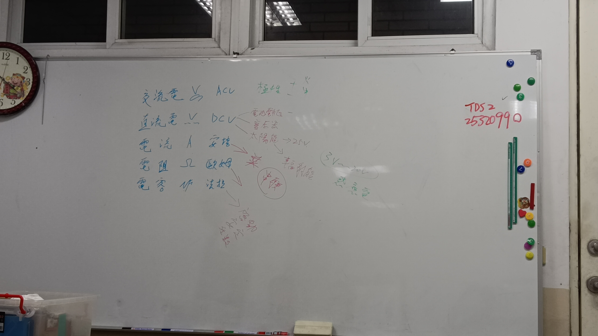
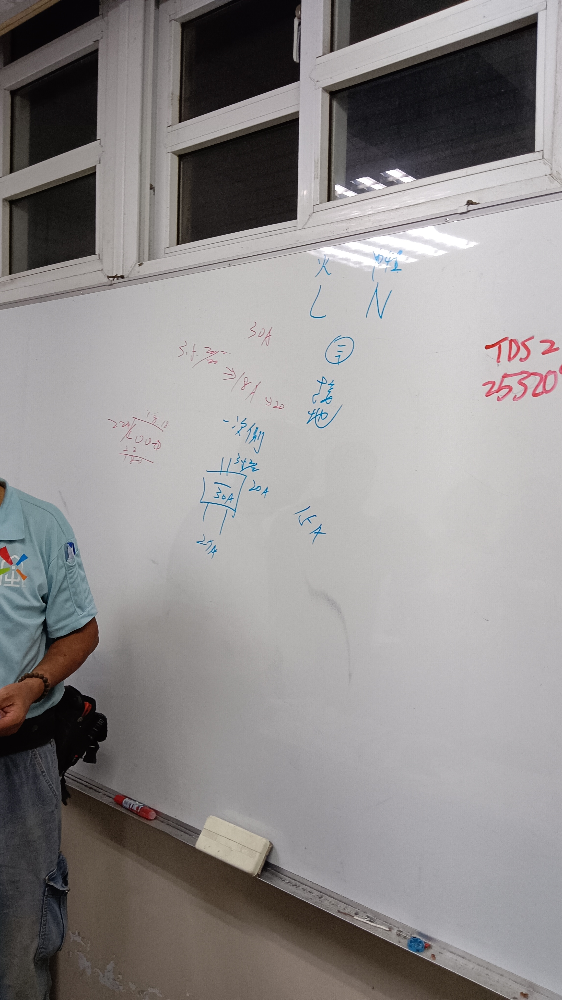
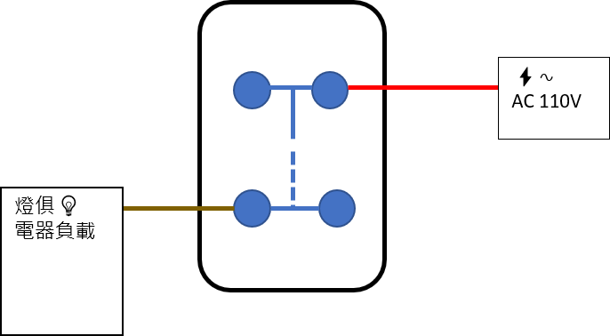
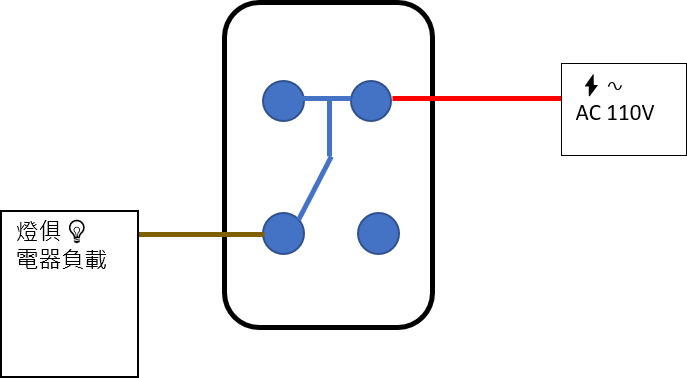
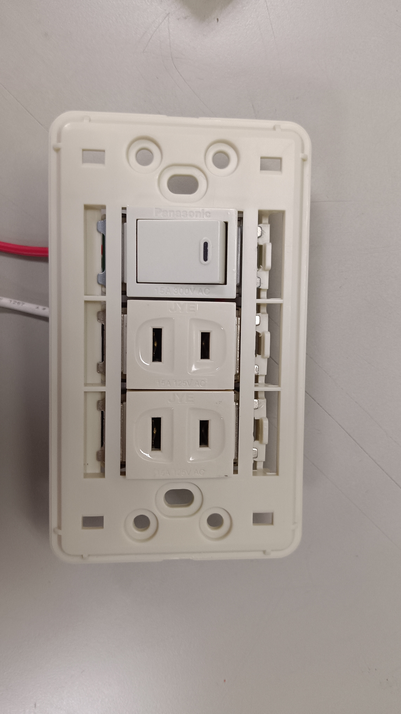
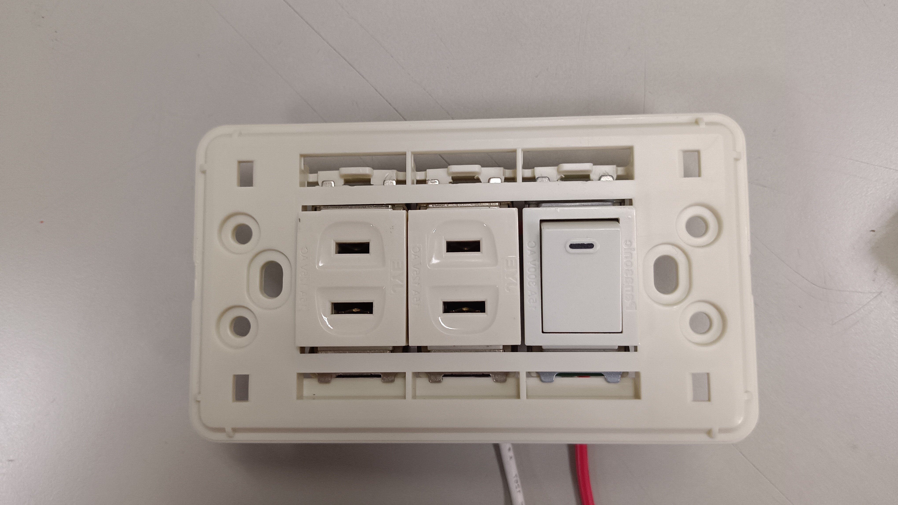
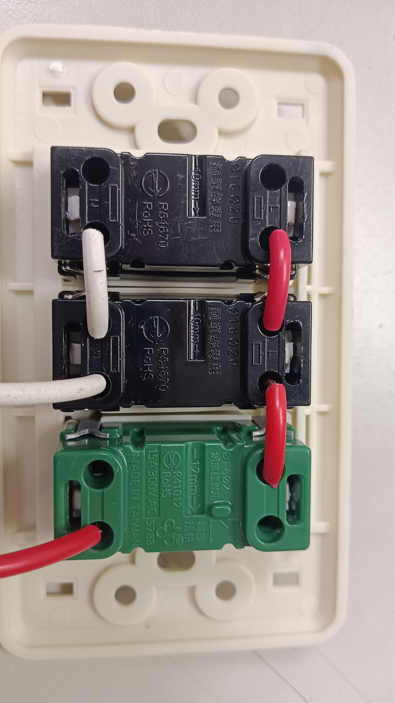

# 水電課堂筆記｜索引與安全校核

> **安全提醒：本資料是學習整理，不是施工圖、負載計算書或法規符合證明。**  
> 目前資料不足以據此選線、選斷路器或接線。涉及市電、配電盤、固定配線、潮濕場所、馬達或太陽光電時，請由合格電器承裝業者／合格人員依現場與現行規定設計、施工及檢驗。不要只憑線色、照片或網路速查表操作。

## 1. 檔案索引

| 主題 | 檔案 | 使用方式 |
|---|---|---|
| 電線載流量、線徑、管路與溫度修正 | [Copilot 整理原文](Copilot_幫我把這兩頁-電線安全電流對照表｜線徑平方安培速查-，-電工法規電線安培容量-做個整理_20261027-1136.md)、[Google 搜尋原文](Google-Search_有沒有居家水電-電流安培數-電壓-與-線徑-的-上限-對照_20261027-1014.md) | 原始搜尋／AI 摘錄；有條件遺漏及互相矛盾處，請先看本文件第 2 節的概念表與限制，不可直接用於選線。 |
| 開關、插座與接線觀察 | `images/單切開關.png`、`images/雙切開關.png`、`images/不知道什麼的開關_三路嗎.jpg`、`images/單切開關控制插座_正面.jpg`、`images/單切開關控制插座_背面.jpg`、`images/單切開關控制插座_鏡像反轉.jpg`、`images/雙切開關_說明.jpg` | 作為課堂照片／示意圖保存；照片與圖示不足以確認端子功能、電源狀態、接地或實際接線是否合規。 |
| 符號 | `images/插座符號.jpg`、`images/電學常用符號及單位.jpg` | 可作為課堂複習圖；模糊或不清楚處應回看原課程確認。 |

## 2. 載流量筆記的校核結論

### 可以保留的基本概念

- 單線常以**導體直徑 mm**表示；絞線常以**導體截面積 mm²**表示，兩者不可只看數字互換。
- 若單線導體是直徑 2.0 mm 的圓形裸銅導體，幾何截面積約為 `π × (2.0 ÷ 2)² = 3.14 mm²`。這是幾何換算，不代表它的允許電流，也不能用來替代電線規格或載流量表。
- 安培容量不是導線的固定「安全上限」：它依導體與絕緣材料、敷設方式、管材、同管載流導線數、環境溫度、端子及其他修正條件而變。官方規則將安培容量定義為**在使用條件下，導線不超過額定溫度時可連續承載的最大電流**。
- 電功率公式 `P = V × I` 可用於理想單相負載的基本估算；實際設備還須看銘牌、功率因數、效率、啟動電流及使用條件，不能只以瓦數除以電壓決定導線與保護器。

### 電學常用符號與單位

| 電學量 | 常用量符號 | 單位名稱 | 單位符號 | 白板內容／補充 |
|---|---|---|---|---|
| 電壓 | `V` | 伏特（volt） | `V` | 交流電壓可標 `ACV`；直流電壓可標 `DCV`。在圖面或儀表上也常見 `V~` 表示交流、`V⎓` 表示直流。 |
| 電流 | `I` | 安培（ampere） | `A` | 白板列出 `A`／安培；注意 `I` 是電流量符號，`A` 是單位符號。 |
| 電阻 | `R` | 歐姆（ohm） | `Ω` | `Ω` 是希臘字母 Omega。 |
| 電容 | `C` | 法拉（farad） | `F` | 白板可見 `μF`；`μ` 是 SI 詞頭「微」（10⁻⁶），所以 `1 μF = 10⁻⁶ F`。 |

容易混淆的地方：`V`、`A`、`Ω`、`F` 是單位符號，而表中的 `I`、`R`、`C` 是描述物理量的常用符號。交流／直流是電壓或電流的性質，不是另一種單位；例如 `AC 110 V` 的單位仍是伏特。白板其他較模糊的旁註未列入，避免把看不清楚的字當成確定內容。

### 插座符號與 emoji

接地符號可以直接用字元 **`⏚`**（Unicode U+23DA，Earth Ground）；它表示接地，不代表插座，也不能證明實際設備已接地。白板照片可辨認 `L`（火線）、`N`（中性線）及接地標記的課堂註記；實際圖面應使用課程或圖例指定的電氣符號，不可單憑符號或線色判斷現場接線。

### 課堂概念用：線徑與載流量參考

下表提供一組**固定條件下的載流量概念值**，讓初學者理解導體規格增加時，表列載流量通常也會增加。數值摘自電線公會頁面所列的表 16-7；不是適用所有住宅配線的「最大電流」或選線建議。

| 導體規格 | 表列載流量（A） |
|---|---:|
| 單線直徑 1.6 mm | 15 |
| 單線直徑 2.0 mm | 19 |
| 單線直徑 2.6 mm | 26 |
| 絞線截面積 3.5 mm² | 19 |
| 絞線截面積 5.5 mm² | 25 |
| 絞線截面積 8 mm² | 33 |
| 絞線截面積 14 mm² | 50 |
| 絞線截面積 22 mm² | 60 |

**這組表值的條件：**銅導線、PVC 絕緣 60°C、PVC 管配線、周圍溫度不高於 35°C，且同一管內載流導線 3 條以下。規格列中的單線以導體直徑 mm 表示，絞線以導體截面積 mm² 表示，兩者不可混為同一種尺寸。

### 表值的限制與不適用情況

- 表列值僅適用於上面列出的條件。若導線絕緣耐熱等級、配管方式、環境溫度、同管載流線數不同，應查相應表格並作適用修正，不可直接套用本表。
- 兩份原始摘錄中的 `1.6 mm = 13 A`、`2.0 mm = 18 A`、`2.6 mm = 24–27 A` 與本表條件下數值不同，原因可能是採用的表格或敷設條件不同；未確認條件前不要混用。
- 金屬管/PVC 管、PVC/XLPE、同管條數和溫度修正表，以及原摘錄中的電器用途建議，均不可脫離各自表格條件使用。
- 「照明、插座、冷氣、電熱水器、IH 爐、馬達、進戶幹線」所列建議線徑，以及「泵浦 1–2 HP 用 5.5 mm²」「距離超過 50 m 升級 8 mm²」等建議，未附完整負載、線長、啟動方式、壓降、保護器及敷設計算，**請勿照抄施工**。
- 「110 V × 15 A = 1650 W」只有算術上的額定乘積；它不代表插座或迴路可長時間安全使用 1650 W，也不能取代設備額定、連續負載、分路配置及保護裝置的校核。
- 「CAT6／RS485 不與 AC 同管」等敘述涉及不同電路的隔離與佈線規定；應依適用規則和設備要求確認，不能以這句話代替完整設計。

## 3. 單切與雙切開關

### 單切開關：一個位置控制負載

單切開關用於一個控制位置，控制一盞燈或其他適用負載的通／斷。概念上，開關改變控制迴路是否連通：接通時負載得電運作，切斷時負載停止。圖上的 `AC 110V` 是示意標示，不可據此判斷現場電壓，也不可由圖中的圓點、線色或虛線推定實物端子名稱。

### 雙切開關：兩個位置控制同一負載

一般課堂所稱的「雙切」通常是指**兩個不同位置都能控制同一盞燈**，例如樓梯上下或走廊兩端。此功能通常由兩個切換型（單刀雙擲，SPDT）開關配合完成；每次扳動其中任一開關，負載的亮／滅狀態會改變。它不是「一個開關面板上有兩個按鍵」的意思；兩鍵面板通常是兩個獨立開關，分別控制負載。

把兩個開關各自的兩種位置抽象記為 A/B，不代表實物端子或安裝方向：

| 開關甲 | 開關乙 | 負載狀態（概念） |
|---|---|---|
| A | A | 通路，負載運作 |
| A | B | 斷路，負載停止 |
| B | A | 斷路，負載停止 |
| B | B | 通路，負載運作 |

實際開關上通常會有一個共用端（常標示 `COM`、`L` 或依型號而異）及切換端；標記方式因產品而異，須以原廠資料為準。`images/雙切開關_說明.jpg` 是課堂白板照片，圖中文字與端子細節不夠清楚，適合回想「兩處控制」概念，**不能當成接線圖**。本節不指定端子對應、導線顏色或施工接法。

### 安全與辨識要點

- 單切是「一處控制」；雙切是「兩處控制同一負載」。切換開關內部接點的不同位置，會改變迴路路徑。
- 「雙切」在日常說法中可能有歧義；確認需求時要說清楚是「兩處控制一盞燈」，還是「兩個按鍵控制兩個負載」。
- 示意圖是原理圖，不是依比例繪製的實體端子圖。圖上的顏色與位置不是線色規範，也不保證對應任何品牌型號。
- 涉及市電的辨識、拆裝、量測或施工，須由合格人員依產品說明及現場確認辦理；不可只關牆壁開關就認定斷電。學習操作請限於教師監督下的斷電教學板。

### 待向老師釐清：`images/不知道什麼的開關_三路嗎.jpg`

白板照片中間的元件看起來畫有四個端點，外觀上**可能**是在說明中途／交叉切換元件，用於兩個雙切開關之間，讓同一負載可由三個或更多位置控制；但照片模糊，端點編號及連線看不清楚，**目前不能確認元件種類或老師當時的講解**。

下次上課請老師確認：

1. 中間這個四端元件的名稱與功能是什麼？是中途／交叉開關，還是其他器件？
2. 圖上的 1、2、3、4（若確為端子編號）各代表什麼？開關切換時，端點間如何改變連通關係？
3. 它是否接在兩個雙切開關之間，用來增加控制位置？整張圖的負載是否為燈具？
4. 課堂上說的「三路」是指三個控制位置，還是器件／接線的其他名稱？

在老師確認前，請將本圖只當作待辨認的課堂照片，不據此推導接線或進行實作。

## 4. 開關與插座圖片的使用限制

- 單切／雙切示意圖可以協助回想課堂概念，但圖中線色、端子位置及虛實線不足以證明任何實際裝置的接線方式。特別是 `images/不知道什麼的開關_三路嗎.jpg`，照片不足以可靠判定器件及端子。
- `images/單切開關控制插座_背面.jpg` 可見器件標示；標示只說明該器件的額定資訊，不證明整個迴路、導線、接地、端接或保護裝置符合規定。不可用照片推定紅／白線就是火線／中性線，也不可照照片接線。
- 插座與開關的端子配置應以**該型號原廠接線圖、端子標示及現場量測**為準。不可依外觀、安裝方向或線色猜測；操作前須由合格人員確認斷電並驗電。

### 單切開關與插座組合面板：照片辨識

- **課堂示範的原理理解：**
1. 紅色電源線(照片右下紅線)由示範板所示的開關電源端進入
2. 單切開關接通／切斷火線；開關控制端再供應插座 L 端。
3. 兩個插座的 L 端以照片可見的紅色跳線相連，因此在此示範原理中兩個插座會一起受開關控制。
4. N（中性線）接到插座 N 端，示範照片可見兩個插座 N 端有白色導線連接；惟線色本身不能證明其功能，實際仍以老師課堂講解及端子標示為準。
- **接地觀察：**正面照片中的插座看起來是兩插孔，沒有清楚可見的接地孔；照片也不足以確認示範板是否另有接地端及接地導線。故只記錄為「本組照片無法確認接地」，不可推定已接地；接地不能以 N 線代替。
- **鏡像／反轉照片：**有助於從另一方向辨認面板各模組相對位置，但方向改變不會提供端子功能資訊；不要依照片左右、上下位置對照實物端子。
- **安全結論：**本段是對老師課堂示範原理的筆記，不是住宅施工接線圖。照片不能完整呈現供電來源、接地或所有導線去向；不可照照片接線或帶電拆裝。實作僅限教師監督下的斷電教學板；住宅固定配線應交由合格人員依現場條件處理。

## 5. 建議的複習順序

1. 先熟悉電壓、電流、電阻、功率及 AC/DC 符號；把導體直徑和截面積的單位分清楚。
2. 再學習分路、過電流保護、漏電保護、接地／搭接、連續負載等概念。
3. 練習看懂法規載流量表的完整條件與修正因素；每次查表都記錄表名、導線規格、絕緣溫度、敷設方式、載流線數、環境溫度及適用條文。
4. 開關與插座先用**斷電的教學實驗板**學習；不要把課堂照片當成住宅現場施工圖。
5. 把負載、保護器、導線、端子與敷設方式視為一組設計；其中任何一項未確認，就不要依速查值施工。

## 6. 來源與查核紀錄

查核日期：2026-10-27。網頁可能更新；實際施工前仍須查核當時有效的規定及產品資料。

- [全國法規資料庫：用戶用電設備裝置規則（PCode J0030018）](https://law.moj.gov.tw/LawClass/LawAll.aspx?pcode=J0030018)：核對「安培容量」、「連續負載」等定義。定義本身不等於已驗證摘錄中的各項載流量數字。
- [全國法規資料庫（PCode J0030017）](https://law.moj.gov.tw/LawClass/LawAll.aspx?pcode=J0030017)：頁面文字列有 110 V／220 V 單相三線式等供電方式。供電方式不代表所有住宅插座或設備均可任意使用該電壓。
- [得榮電線：電線安全電流對照表](https://derrong.com.tw/ampacity-table)：原筆記引用的廠商資料，屬二手參考；應與現行法規及線材原廠資料核對。
- [電線公會：電工法規電線安培容量](https://www.wire.com.tw/ampere.htm)：概念表取自該頁表 16-7（PVC 管配線、PVC 絕緣 60°C、周溫 35°C 以下、同管載流導線 3 條以下）；該頁另列其他敷設條件及不同數值。此為參考資料，不能抽取單一數字當作通用值。

**尚未完成的查核：**表 16-7 的數字依電線公會網頁整理，尚未逐項對照官方現行法規原表；兩個民間網站的其他表格、修正係數、電器用途建議和開關接線圖也未全部核實。因此概念表僅供學習認識條件與量級，不可標記為已完成施工設計或法規符合確認。
